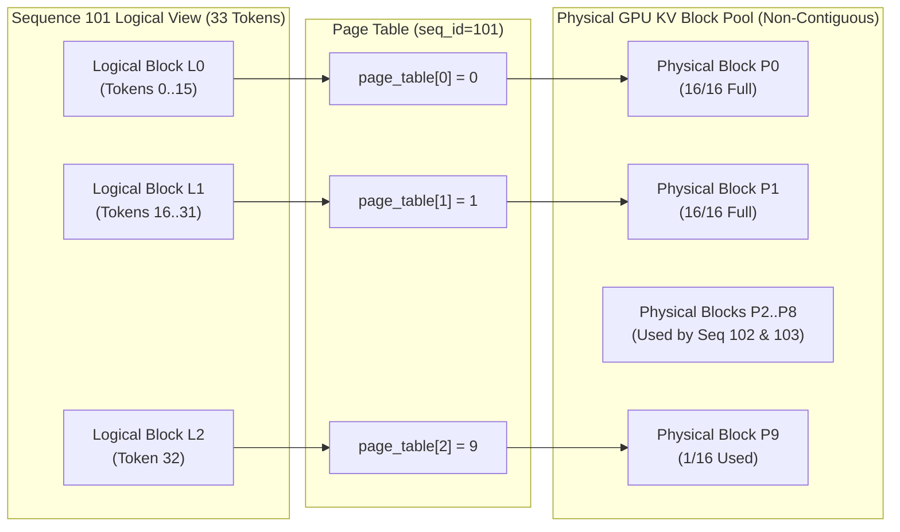
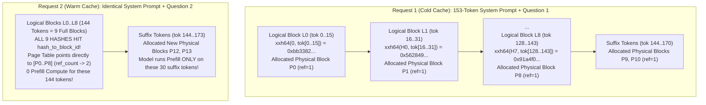

# Local-vLLM: From-Scratch Optimized LLM Inference Engine (`sm_75` / GTX 1650)

A complete, educational-yet-functional Large Language Model (LLM) inference engine built from scratch in **PyTorch** and **Triton**, replicating the core systems optimizations of **vLLM** (`nano-vllm`, `MinivLLM`) and **SGLang** while specifically targeting an **NVIDIA GeForce GTX 1650** (4 GB GDDR VRAM, Turing architecture `sm_75`, native `float16`).

This document serves both as the **Project Guide** and a **Deep-Dive Textbook on Modern LLM Inference Systems**—bridging basic Deep Learning (Transformers, PyTorch, Attention) and Computer Systems (OS Virtual Memory, GPU SRAM/VRAM Hierarchy, Triton Kernel Programming, Prefix Hashing, and CUDA Graphs).

---

## Table of Contents

1. [Repository Structure & Quick-Start Commands](#1-repository-structure--quick-start-commands)
2. [The Fundamental Bottlenecks of LLM Inference (Compute vs. Memory Bandwidth)](#2-the-fundamental-bottlenecks-of-llm-inference-compute-vs-memory-bandwidth)
3. [Step 0: Hardware Constraints of Turing `sm_75` (GTX 1650)](#3-step-0-hardware-constraints-of-turing-sm_75-gtx-1650)
4. [Phase 1: The Transformer Scaffold & Why Naive Contiguous KV Caches Fail](#4-phase-1-the-transformer-scaffold--why-naive-contiguous-kv-caches-fail)
   * [RMSNorm (`float32` Variance Accumulation)](#41-rmsnorm-float32-variance-accumulation)
   * [Rotary Position Embeddings (RoPE)](#42-rotary-position-embeddings-rope)
   * [Grouped-Query Attention (GQA) & SwiGLU MLP](#43-grouped-query-attention-gqa--swiglu-mlp)
   * [The Memory Crisis of Naive `ContiguousKVCache`](#44-the-memory-crisis-of-naive-contiguouskvcache)
5. [Phase 2: The Block Manager — OS Virtual Memory for the KV Cache](#5-phase-2-the-block-manager--os-virtual-memory-for-the-kv-cache)
   * [Logical vs. Physical Blocks & The Page Table](#51-logical-vs-physical-blocks--the-page-table)
   * [Mathematical Address Translation (`resolve_logical_token`)](#52-mathematical-address-translation-resolve_logical_token)
   * [Lifecycle of a Sequence's Blocks](#53-lifecycle-of-a-sequences-blocks)
6. [Phase 3: Continuous Batching & The Two-Stage Iteration Scheduler](#6-phase-3-continuous-batching--the-two-stage-iteration-scheduler)
   * [Static (Batch-Level) vs. Continuous (Iteration-Level) Batching](#61-static-batch-level-vs-continuous-iteration-level-batching)
   * [Two-Stage Execution: Prefill vs. Decode](#62-two-stage-execution-prefill-vs-decode)
   * [Walkthrough of Our Continuous Batching Execution Trace](#63-walkthrough-of-our-continuous-batching-execution-trace)
7. [Phase 4: Custom Triton Kernels for PagedAttention](#7-phase-4-custom-triton-kernels-for-pagedattention)
   * [GPU Memory Hierarchy: HBM/GDDR6 vs. L2 vs. Shared Memory (SRAM) vs. Registers](#71-gpu-memory-hierarchy-hbmgddr6-vs-l2-vs-shared-memory-sram-vs-registers)
   * [Kernel 1: `_reshape_and_cache_kernel` (Physical Slot Scatter)](#72-kernel-1-_reshape_and_cache_kernel-physical-slot-scatter)
   * [Kernel 2: `_paged_attention_decode_kernel` & Online Softmax](#73-kernel-2-_paged_attention_decode_kernel--online-softmax)
   * [Why Online Softmax Avoids Materializing the Attention Matrix](#74-why-online-softmax-avoids-materializing-the-attention-matrix)
   * [Tuning Triton Kernels for Turing `sm_75` vs. Ampere `sm_80`](#75-tuning-triton-kernels-for-turing-sm_75-vs-ampere-sm_80)
8. [Phase 5: Advanced Optimizations — Prefix Caching (`xxhash`) & CUDA Graphs](#8-phase-5-advanced-optimizations--prefix-caching-xxhash--cuda-graphs)
   * [Task 1: Automatic Prefix Caching (APC) with Chained `xxhash64`](#81-task-1-automatic-prefix-caching-apc-with-chained-xxhash64)
   * [Task 2: CUDA Graph Capture & Replay for Zero-Overhead Decoding](#82-task-2-cuda-graph-capture--replay-for-zero-overhead-decoding)
9. [Architectural Comparison: Local-vLLM vs. Production vLLM vs. SGLang](#9-architectural-comparison-local-vllm-vs-production-vllm-vs-sglang)

---

## 1. Repository Structure & Quick-Start Commands

| Phase | Core File(s) | Verification / Benchmark Script | Command (`uv`) |
| :--- | :--- | :--- | :--- |
| **Step 0: Hardware & Env Check** | [verify_env.py](verify_env.py) | [verify_env.py](verify_env.py) | `uv run verify_env.py` |
| **Phase 1: Model & Naive KV Loop** | [model.py](model.py) | [test_phase1.py](test_phase1.py) | `uv run test_phase1.py` |
| **Phase 2: Virtual Memory Block Manager** | [block_manager.py](block_manager.py) | [test_phase2.py](test_phase2.py) | `uv run test_phase2.py` |
| **Phase 3: Continuous Batching Scheduler** | [scheduler.py](scheduler.py) | [test_phase3.py](test_phase3.py) | `uv run test_phase3.py` |
| **Phase 4: Triton PagedAttention Kernels** | [paged_attention.py](paged_attention.py) | [test_phase4.py](test_phase4.py), [benchmark_decoding.py](benchmark_decoding.py) | `uv run test_phase4.py`<br>`uv run benchmark_decoding.py` |
| **Phase 5: Prefix Caching & CUDA Graphs** | [engine.py](engine.py), [block_manager.py](block_manager.py) | [test_phase5.py](test_phase5.py) | `uv run test_phase5.py` |

---

## 2. The Fundamental Bottlenecks of LLM Inference (Compute vs. Memory Bandwidth)

To understand why systems like **vLLM** and **SGLang** exist, we must first understand the two distinct physical regimes of autoregressive Transformer inference:

### Regime A: The Prefill Stage (Compute-Bound)
When a user sends a prompt of $N = 512$ tokens, all 512 tokens are known at once.
* Every Linear layer (`q_proj`, `k_proj`, `v_proj`, `o_proj`, `gate_proj`, `up_proj`, `down_proj`) performs a **Matrix-Matrix Multiplication (GEMM)**:
  $$[512, D_{\text{in}}] \times [D_{\text{in}}, D_{\text{out}}]$$
* The GPU loads the weight matrix $[D_{\text{in}}, D_{\text{out}}]$ from global VRAM **once** and reuses it across all 512 tokens inside its Tensor Cores.
* **Arithmetic Intensity** (FLOPs per byte read from VRAM) is high. Prefill is **compute-bound**; skipping redundant tokens (via **Phase 5 Prefix Caching**) directly saves massive matrix-multiply FLOPs.

### Regime B: The Decode Stage (Memory-Bandwidth-Bound & Launch-Overhead-Bound)
Once the first token is generated, the LLM generates subsequent tokens **one token at a time** ($N = 1$ per sequence):
* For a single sequence, every Linear layer degrades into a **Matrix-Vector Multiplication (GEMV)**:
  $$[1, D_{\text{in}}] \times [D_{\text{in}}, D_{\text{out}}]$$
* Furthermore, the Attention layer must read the entire historical **Key-Value (KV) Cache** of all past tokens $t \in [0..T-1]$ from global VRAM just to compute the attention output for 1 new token.
* Because arithmetic intensity is $\approx 1\text{–}2$ FLOPs/byte, the GPU Tensor Cores sit mostly idle waiting for bytes to travel from GDDR6 VRAM into registers (**memory-bandwidth-bound**), OR waiting for the CPU Python interpreter to dispatch hundreds of tiny CUDA kernels (**CPU launch-overhead-bound**).

Every optimization in Phases 2–5 attacks one of these exact bottlenecks:
* **Phase 2 & 4 (BlockSpaceManager + PagedAttention):** Eliminates 60–80% KV cache memory waste so we can fit **larger batches** in VRAM (turning GEMV $[1, D] \times [D, D]$ into batched GEMM $[B, D] \times [D, D]$) and reads KV blocks directly in a single fused Triton kernel.
* **Phase 3 (Continuous Batching):** Keeps the active batch size $B$ constantly full by immediately replacing finished short sequences with new waiting requests.
* **Phase 5 (Prefix Caching + CUDA Graphs):** Eliminates redundant prefill compute via `xxhash` block sharing and eliminates Python CPU kernel-launch overhead during decode via `torch.cuda.CUDAGraph`.

---

## 3. Step 0: Hardware Constraints of Turing `sm_75` (GTX 1650)

In [verify_env.py](verify_env.py), we inspect and enforce three hardware constraints specific to the **NVIDIA GeForce GTX 1650**:

1. **Compute Capability `7.5` (`sm_75` - Turing Architecture):**
   * Introduced first-/second-generation Tensor Cores supporting native **FP16 (`torch.float16`)** matrix instructions (`mma.sync.aligned.m16n8k8`), but **no hardware `bfloat16` (`bf16`)**.
   * Attempting to run a model in `bfloat16` on `sm_75` either fails in custom kernels or triggers slow software emulation. We therefore enforce `torch.set_default_dtype(torch.float16)` across the entire engine.
2. **4 GB Total VRAM (~3.63 GB usable):**
   * With `Qwen/Qwen2.5-0.5B` occupying ~1.21 GB of VRAM in `float16`, only ~2.4 GB remains for activations, KV cache blocks, and CUDA Graph pools. Memory fragmentation is fatal at this scale.
3. **64 KB Maximum Shared Memory (SRAM) per Streaming Multiprocessor (SM):**
   * Newer Ampere (`sm_80`, A100: 164 KB) and Hopper (`sm_90`, H100: 228 KB) GPUs have 2.5x–3.5x more on-chip shared memory per SM than Turing (`sm_75`: 64 KB max).
   * Large Triton tiles (e.g., `BLOCK_M=128, BLOCK_N=128, HEAD_DIM=128`) that compile on an A100 will throw `OutOfResources: out of resource: shared memory` on a GTX 1650. Our Phase 4 Triton kernels use compact `[BLOCK_SIZE=16, BLOCK_D=64]` tiles (only 2 KB per K or V tile) with `num_warps=2`, running effortlessly on `sm_75`.

---

## 4. Phase 1: The Transformer Scaffold & Why Naive Contiguous KV Caches Fail

In [model.py](model.py), we implement [`CustomLlamaForCausalLM`](model.py) from scratch in pure PyTorch, loading weights directly from `.safetensors` without relying on HuggingFace's model wrapper.

### 4.1 RMSNorm (`float32` Variance Accumulation)
Standard LayerNorm subtracts the mean and divides by standard deviation. LLaMA and Qwen2 use **Root Mean Square Layer Normalization (`RMSNorm`)**:
$$\text{RMSNorm}(x) = \frac{x}{\sqrt{\frac{1}{D}\sum_{i=1}^{D} x_i^2 + \epsilon}} \odot w$$

In [`RMSNorm.forward`](model.py), notice how we upcast `x` to `torch.float32` before squaring:
```python
x_fp32 = x.to(torch.float32)
variance = x_fp32.pow(2).mean(-1, keepdim=True)
x_normed = x_fp32 * torch.rsqrt(variance + self.eps)
return self.weight * x_normed.to(input_dtype)
```
**Why?** In `float16`, the maximum representable number is `65,504`. Squaring hidden activations ($x_i^2$) and summing across $D = 896$ dimensions in `float16` easily overflows to `inf`, producing `NaN` outputs. Upcasting the reduction to `float32` makes our `RMSNorm` **bitwise identical (`max_diff = 0.0`)** to HuggingFace's implementation.

### 4.2 Rotary Position Embeddings (RoPE)
Instead of adding absolute positional embeddings to token embeddings, [`RotaryEmbedding`](model.py) encodes relative token distance by rotating pairs of query and key dimensions $(x_{i}, x_{i + d/2})$ in the 2D complex plane by an angle $m \theta_i$, where $m$ is the token's sequence position and $\theta_i = \text{base}^{-2i/d}$:
$$\begin{pmatrix} q'_{i} \\ q'_{i + d/2} \end{pmatrix} = \begin{pmatrix} \cos(m\theta_i) & -\sin(m\theta_i) \\ \sin(m\theta_i) & \cos(m\theta_i) \end{pmatrix} \begin{pmatrix} q_{i} \\ q_{i + d/2} \end{pmatrix}$$
Because the dot product $(R_m q)^\top (R_n k) = q^\top R_{n-m} k$ depends only on the relative distance $m - n$, RoPE naturally generalizes to arbitrary positions and allows **Prefix Caching (Phase 5)** to reuse cached Key vectors without any positional modification!

### 4.3 Grouped-Query Attention (GQA) & SwiGLU MLP
* **Grouped-Query Attention (GQA):** In `Qwen2.5-0.5B`, there are $H_q = 14$ Query heads but only $H_{kv} = 2$ Key/Value heads (`num_kv_groups = 7`). Every group of 7 Query heads shares 1 Key head and 1 Value head. This shrinks the KV cache footprint in VRAM by **$7\times$** compared to standard Multi-Head Attention!
* **SwiGLU MLP:** Replaces the traditional 2-layer ReLU FFN with a gated linear unit using the Swish (`SiLU`) activation:
  $$\text{SwiGLU}(x) = W_{\text{down}}\big(\text{SiLU}(W_{\text{gate}} x) \odot (W_{\text{up}} x)\big)$$

### 4.4 The Memory Crisis of Naive `ContiguousKVCache`
In Phase 1, [`ContiguousKVCache`](model.py) allocates a single static tensor upfront:
```python
# Shape: [num_layers, batch_size, num_kv_heads, max_seq_len, head_dim]
```
For `Qwen2.5-0.5B` ($L=24, H_{kv}=2, D=64$, `float16` = 2 bytes):
* Each token's KV cache across all 24 layers costs:
  $$2 \text{ (K and V)} \times 24 \times 2 \times 64 \times 2\text{ bytes} = 12,288\text{ bytes} = 12\text{ KB/token}$$
* If we pre-allocate `batch_size = 8` with `max_seq_len = 2048` upfront (as demonstrated in `test_phase1.py`), we immediately lock up:
  $$8 \times 2048 \times 12\text{ KB} = \mathbf{192\text{ MB of VRAM}}$$
  even when the prompt is only 10 tokens long (**99.5% internal fragmentation**)! Worse, for a 7B model ($L=32, H_{kv}=8, D=128$), a single 2048-token slot costs **256 MB**, and `batch_size = 8` would require **2 GB** of contiguous VRAM before generating a single token.

---

## 5. Phase 2: The Block Manager — OS Virtual Memory for the KV Cache

To eliminate KV cache fragmentation, **vLLM** introduced **PagedAttention**, inspired directly by **Operating System Virtual Memory**. In Phase 2 ([block_manager.py](block_manager.py)), we build the virtual memory control plane: [`BlockSpaceManager`](block_manager.py) and [`PhysicalBlock`](block_manager.py).

### 5.1 Logical vs. Physical Blocks & The Page Table
Just as an OS divides physical RAM into 4 KB page frames and gives each process a virtual address space mapped via a page table:
1. We divide our GPU KV cache pool into fixed-size **Physical Blocks** (`block_size = 16` tokens per block).
   * For `Qwen2.5-0.5B`, one 16-token physical block across all 24 layers costs $16 \times 12\text{ KB} = 192\text{ KB}$.
2. Each sequence sees a contiguous stream of **Logical Tokens** `0, 1, 2, ..., T-1`, grouped into 16-token **Logical Blocks** `L0, L1, L2, ...`.
3. The [`BlockSpaceManager`](block_manager.py) maintains `page_tables: Dict[int, List[int]]`, mapping each sequence's logical block index to a physical block index anywhere in VRAM:



### 5.2 Mathematical Address Translation (`resolve_logical_token`)
When a sequence wants to read or write token at `logical_token_idx` (e.g., token `34` in `Seq 103` whose page table is `[P6, P7, P8]`), [`BlockSpaceManager.resolve_logical_token`](block_manager.py) translates the virtual index into a physical VRAM slot in $O(1)$ arithmetic:

$$\text{logical\_block\_idx} = \lfloor 34 / 16 \rfloor = 2$$

$$\text{block\_offset} = 34 \bmod 16 = 2$$

$$\text{physical\_block\_id} = \text{page\_tables}[103][2] = 8$$

$$\text{global\_physical\_slot} = 8 \times 16 + 2 = 130$$

### 5.3 Lifecycle of a Sequence's Blocks
1. **Prefill Allocation (`allocate`):** A 20-token prompt needs $\lceil 20 / 16 \rceil = 2$ physical blocks (`P0` gets 16 tokens; `P1` gets 4 tokens and has 12 free slots left).
2. **On-Demand Decode Growth (`append_slot`):**
   * Tokens `20..31` fill the remaining 12 slots of `P1` (**zero new blocks allocated**).
   * When token `32` is generated (`32 % 16 == 0`), `P1` is full. `append_slot` pops the next available physical block from `free_block_ids` (say `P9`, because `P2..P8` were allocated to other requests in the meantime) and appends `P9` to `page_tables[seq_id] -> [0, 1, 9]`.
3. **Instant Eviction & Reclamation (`free`):** When a request finishes, `free(seq_id)` decrements `ref_count` on its physical blocks and pushes any block with `ref_count == 0` back into `free_block_ids`. Internal fragmentation is bounded to at most $15$ token slots per sequence (the partially filled final block).

---

## 6. Phase 3: Continuous Batching & The Two-Stage Iteration Scheduler

### 6.1 Static (Batch-Level) vs. Continuous (Iteration-Level) Batching

In naive **Static Batching**, if you batch 3 prompts that generate `10`, `50`, and `150` tokens respectively:
* All 3 sequences are locked together until the longest sequence finishes at step 150.
* Sequence 1 finishes at step 10, but its GPU memory remains locked and it wastes compute generating 140 useless padding tokens (`<pad>`).
* Incoming requests in the waiting queue cannot enter the GPU until step 150 completes (**head-of-line blocking**).

In **Phase 3** ([scheduler.py](scheduler.py)), [`ContinuousBatchScheduler`](scheduler.py) shifts scheduling from the **batch level** to the **iteration (token) level** (originally pioneered by *Orca* and adopted by **vLLM** and **SGLang**):

```mermaid
sequenceDiagram
    participant W as Waiting Queue
    participant S as ContinuousBatchScheduler
    participant R as Running Batch (Max=2)
    participant BM as BlockSpaceManager

    Note over W,BM: Step 1: Seq 1 (10 tok), Seq 2 (150 tok), Seq 3 (50 tok) queued
    W->>S: Pull Seq 1 & Seq 2 (PREFILL ADMIT)
    S->>BM: Allocate P0 for Seq 1, P1 for Seq 2
    S->>R: Running = [Seq 1, Seq 2] | Waiting = [Seq 3]

    Note over R,BM: Steps 2..9: Decode 1 token/step; Seq 2 grows into P2
    Note over R,BM: Step 10: Seq 1 hits 10th token (EOS_TOKEN)!
    R->>S: Immediately Evict Seq 1 -> FINISHED
    S->>BM: Free Seq 1's physical block [P0]

    Note over W,BM: Step 11: Slot opened! Admit Seq 3 mid-flight!
    W->>S: Pull Seq 3 (PREFILL ADMIT) while Seq 2 is at 10/150 tokens
    S->>BM: Allocate P3 for Seq 3
    S->>R: Running = [Seq 2 (Decode), Seq 3 (Prefill->Decode)]
```

### 6.2 Two-Stage Execution: Prefill vs. Decode
At every iteration (`engine.step()` in [`ContinuousBatchEngine`](scheduler.py)):
1. **`schedule()`:**
   * Inspects currently `RUNNING` sequences that have already completed prefill and schedules them for **Decode** (checking how many will cross a 16-token boundary on this step so their block growth is guaranteed).
   * Inspects the `WAITING` queue. If `len(running) < max_running_seqs` and `BlockSpaceManager` has enough free physical blocks for the candidate's prompt, pulls the request from `WAITING -> RUNNING` and schedules it for **Prefill**.
2. **`update_after_step()`:**
   * Appends each sequence's newly generated token into `BlockSpaceManager.append_slot`.
   * Checks if any sequence generated `eos_token_id` or reached `max_new_tokens`.
   * If so, **immediately evicts** that sequence (`RUNNING -> FINISHED`) and calls `block_manager.free(seq_id)` so a waiting request can claim its slot on the very next iteration (`step + 1`).

### 6.3 Walkthrough of Our Continuous Batching Execution Trace
When you run `uv run test_phase3.py`:
* **Step 001:** `Seq 1` (10-token target) and `Seq 2` (150-token target) are admitted (`Running=[Seq 1, Seq 2]`, `Waiting=[Seq 3]`).
* **Step 010:** `Seq 1` hits `EOS_TOKEN` after 10 tokens, is evicted immediately, and frees block `[0]`.
* **Step 011:** `Seq 3` (50-token target) is immediately pulled from `WAITING -> RUNNING` (`PREFILL ADMIT`) while `Seq 2` is at `11/150` tokens.
* **Steps 013–050:** As `Seq 2` and `Seq 3` decode side-by-side, their 16-token block allocations interleave in physical VRAM:
  * `Seq 2` page table: `[1, 2, 5, 7, 9]`
  * `Seq 3` page table: `[3, 4, 6, 8]`
* **Step 060:** `Seq 3` finishes its 50 tokens and frees `[3, 4, 6, 8]`, leaving `Seq 2` to finish at **Step 150** (`Completion Order: Seq 1 -> Seq 3 -> Seq 2`).

---

## 7. Phase 4: Custom Triton Kernels for PagedAttention

In Phases 2 and 3, we built the virtual memory page table in Python. In **Phase 4** ([paged_attention.py](paged_attention.py)), we build the **GPU Data Plane**: custom **OpenAI Triton** GPU kernels that scatter and gather Key/Value vectors directly across non-contiguous physical blocks in VRAM without copying tensors into contiguous buffers.

### 7.1 GPU Memory Hierarchy: HBM/GDDR6 vs. L2 vs. Shared Memory (SRAM) vs. Registers

```text
+-----------------------------------------------------------------------+
|  GPU Chip (NVIDIA GeForce GTX 1650 - Turing sm_75)                    |
|                                                                       |
|  +------------------------------+   +------------------------------+  |
|  | Streaming Multiprocessor (SM)|   | Streaming Multiprocessor (SM)|  |
|  |  +------------------------+  |   |  +------------------------+  |  |
|  |  | Registers (256 KB/SM)  |  |   |  | Registers (256 KB/SM)  |  |  |
|  |  | (~10+ TB/s, 1 cycle)   |  |   |  | (~10+ TB/s, 1 cycle)   |  |  |
|  |  +-----------+------------+  |   |  +-----------+------------+  |  |
|  |              ^               |   |              ^               |  |
|  |  +-----------+------------+  |   |  +-----------+------------+  |  |
|  |  | Shared Memory / SRAM   |  |   |  | Shared Memory / SRAM   |  |  |
|  |  | (Max 64 KB per SM!)    |  |   |  | (Max 64 KB per SM!)    |  |  |
|  |  +-----------+------------+  |   |  +-----------+------------+  |  |
|  +--------------|---------------+   +--------------|---------------+  |
|                 +----------------+-----------------+                  |
|                                  v                                    |
|                    +---------------------------+                      |
|                    |      L2 Cache (1 MB)      |                      |
|                    +-------------+-------------+                      |
+----------------------------------|------------------------------------+
                                   v  (~128–192 GB/s Bus)
                    +-----------------------------+
                    |  Global GDDR VRAM (4.0 GB)  |
                    |  PagedKVCachePool lives here|
                    +-----------------------------+
```

In [`PagedKVCachePool`](paged_attention.py), we allocate the physical block pool once in global GDDR VRAM:
```python
k_cache: [num_layers, num_blocks, num_kv_heads, block_size=16, head_dim=64]  # float16
v_cache: [num_layers, num_blocks, num_kv_heads, block_size=16, head_dim=64]  # float16
```

### 7.2 Kernel 1: `_reshape_and_cache_kernel` (Physical Slot Scatter)
Whenever the model computes new `k` and `v` projections of shape `[num_tokens, num_kv_heads, head_dim]`, [`_reshape_and_cache_kernel`](paged_attention.py) launches a 2D grid of `(num_tokens, num_kv_heads)` Triton programs:
1. Program `(token_idx, kv_head_idx)` loads `slot_idx = slot_mapping[token_idx]`.
   * If `slot_idx < 0` (used for inactive batch rows during CUDA Graph replay), the program exits immediately (`return`).
2. It decomposes `slot_idx` into:
   ```python
   physical_block_id = slot_idx // block_size
   block_offset = slot_idx % block_size
   ```
3. It coalesces a 64-element vector read (`offs_d = tl.arange(0, 64)`) from `k` and `v` and writes directly into `k_cache[physical_block_id, kv_head_idx, block_offset, :]` and `v_cache[physical_block_id, kv_head_idx, block_offset, :]`.

### 7.3 Kernel 2: `_paged_attention_decode_kernel` & Online Softmax
During decoding, each sequence in the batch has a single query token $q \in \mathbb{R}^{1 \times D}$ per query head (`q` has shape `[batch_size, num_heads, head_dim]`), while its historical Keys and Values are scattered across non-contiguous physical blocks listed in `block_tables[seq_idx, :]`.

[`_paged_attention_decode_kernel`](paged_attention.py) launches a grid of `(batch_size, num_heads)` Triton programs:
1. **GQA Head Mapping:** Each query head `head_idx` computes its corresponding KV head:
   ```python
   kv_head_idx = head_idx // num_kv_groups  # e.g., 14 query heads // 7 = 2 KV heads
   ```
2. **Register-Resident Query:** The query vector `q` (`64` floats) is loaded into on-chip registers **once** before the loop.
3. **Page Table Traversal Loop:** The kernel iterates over `logical_block_idx` from `0` to `cdiv(seq_len, 16) - 1`:
   * Reads `physical_block_id = tl.load(block_tables_ptr + seq_idx * stride_bt_b + logical_block_idx)`.
   * Loads the $[16 \times 64]$ Key block `k_block` from `k_cache[physical_block_id, kv_head_idx, :, :]`, masking out any slot beyond `seq_len`.
   * Computes the 16 attention scores for that block:
     $$\text{qk}_j = \frac{q \cdot k_j}{\sqrt{D}}, \quad j \in \{0..15\}$$
   * Updates the **Online Softmax** accumulators (`m_i`, `l_i`, `acc`) and loads the $[16 \times 64]$ Value block `v_block` from `v_cache[physical_block_id, kv_head_idx, :, :]`.

### 7.4 Why Online Softmax Avoids Materializing the Attention Matrix
Standard softmax over a sequence of length $T$ requires two passes:
$$\text{Pass 1: } m = \max_{t=1..T} s_t, \quad \ell = \sum_{t=1}^{T} e^{s_t - m} \qquad \text{Pass 2: } o = \sum_{t=1}^{T} \frac{e^{s_t - m}}{\ell} v_t$$
Wait: if you have to compute $m$ across all $T$ tokens before multiplying by $v_t$, you would either have to store all $T$ scores in global VRAM or read the `k_cache` from VRAM twice!

**Online Softmax** (used in FlashAttention and our `_paged_attention_decode_kernel`) maintains a running maximum $m^{(i)}$, a running normalizer $\ell^{(i)}$, and an unnormalized output accumulator $a^{(i)}$ as it visits each 16-token physical block $B_i$:

$$m_{\text{new}} = \max\big(m_{\text{old}}, \max_{j \in B_i} \text{qk}_j\big)$$

$$\alpha = e^{m_{\text{old}} - m_{\text{new}}}, \qquad p_j = e^{\text{qk}_j - m_{\text{new}}}$$

$$\ell_{\text{new}} = \ell_{\text{old}} \cdot \alpha + \sum_{j \in B_i} p_j$$

$$a_{\text{new}} = a_{\text{old}} \cdot \alpha + \sum_{j \in B_i} p_j v_j$$

When a new block contains a larger logit ($m_{\text{new}} > m_{\text{old}}$), multiplying the previous accumulator $a_{\text{old}}$ by $\alpha = e^{m_{\text{old}} - m_{\text{new}}}$ rescales all past contributions in registers instantaneously! At the end of the loop, a single division `out = a / l` produces the exact softmax attention output in **one single pass** over the physical KV blocks.

### 7.5 Tuning Triton Kernels for Turing `sm_75` vs. Ampere `sm_80`
Why does our kernel compile and run cleanly on a GTX 1650 (`sm_75`) where many open-source FlashAttention/PagedAttention kernels fail?
* **Vector-Tile Reduction (`tl.sum(q[None, :] * k_block, axis=1)`) for $M=1$ Decode:** During single-token decoding ($M=1$), the query is a 1D vector of length 64, not a matrix. Triton's `tl.dot` enforces a minimum matrix tile of $16 \times 16 \times 16$ (which pads $M=1$ with 15 rows of wasted zeros and invokes Tensor Core MMA instructions often tuned for `sm_80+`). Computing the vector-tile dot product directly in registers avoids wasted 15/16 padding and has zero `sm_80` instruction dependencies.
* **Compact SRAM Footprint:** Each program holds only one `[16, 64]` tile of $K$ or $V$ at a time ($16 \times 64 \times 2\text{ bytes} = 2\text{ KB}$) with `num_warps=2`, allowing dozens of thread blocks to execute concurrently per SM within Turing's 64 KB shared memory limit.

---

## 8. Phase 5: Advanced Optimizations — Prefix Caching (`xxhash`) & CUDA Graphs

### 8.1 Task 1: Automatic Prefix Caching (APC) with Chained `xxhash64`

In real-world LLM applications (chatbots with long system instructions, RAG over shared documents, few-shot prompts, multi-turn conversations), requests repeatedly share the exact same prefix of tokens.

In **Phase 5**, [`BlockSpaceManager.allocate_with_prefix_cache`](block_manager.py) implements **vLLM-style Hash-Based Automatic Prefix Caching**:

#### How Chained Block Hashing Works
Why can't we just hash the 16 token IDs inside a block by themselves?
Because of **Causal Attention and RoPE**: a 16-token block containing `"The capital of France is Paris..."` at tokens `16..31` has completely different Key and Value vectors than the exact same 16 tokens appearing at tokens `160..175` or following a different preceding sentence!

To guarantee that a cached physical block is reused **only** when its entire historical prefix from token `0` matches identically, [`BlockSpaceManager.compute_block_hash`](block_manager.py) computes a **chained 64-bit `xxhash` (`xxh64`)** resembling a blockchain:

$$H_0 = \text{xxh64}\big(\text{parent}=0 \,\|\, \text{tokens}[0..15]\big)$$

$$H_1 = \text{xxh64}\big(\text{parent}=H_0 \,\|\, \text{tokens}[16..31]\big)$$

$$H_k = \text{xxh64}\big(\text{parent}=H_{k-1} \,\|\, \text{tokens}[16k..16k+15]\big)$$



#### Zero-Copy Sharing & Partial Suffix Prefill
When Request 2 arrives with the same 153-token system prompt (`9` full 16-token blocks = `144` tokens):
1. `allocate_with_prefix_cache` computes $H_0, H_1, \dots, H_8$ in microseconds using `xxhash`.
2. Every hash hits `self.hash_to_block_id`!
3. Request 2's page table entries `L0..L8` are pointed directly to Request 1's physical blocks `[P0, P1, P2, P3, P4, P5, P6, P7, P8]` and their `ref_count` is incremented to `2`.
4. Only Request 2's unique suffix (`30` tokens) gets new physical blocks (`P12, P13`).
5. In [`OptimizedPagedEngine.generate`](engine.py), `model.forward_prefill` passes **only the 30 uncached suffix tokens** (`input_ids[:, 144:]`, with `position_ids = [144..173]`) through the 24 Transformer layers, scatters those 30 new K/V vectors into `P12, P13`, and attends over the full 174-token context `[P0..P8, P12, P13]`.
6. **Lazy Eviction on `free()`:** When Request 1 finishes, `free(seq_id=1)` decrements `ref_count` on `P0..P8` from `2 -> 1`. Even after Request 2 finishes (`ref_count: 1 -> 0`), those physical blocks keep their `block_hash` in `hash_to_block_id` at the tail of `free_block_ids` so a 3rd request can reclaim them (`ref_count: 0 -> 1`) before they are eventually overwritten!

---

### 8.2 Task 2: CUDA Graph Capture & Replay for Zero-Overhead Decoding

#### Why Python Overhead Dominates Small-Batch Decoding
In `Qwen2.5-0.5B` (24 layers), a single decode step launches **over 200 individual GPU kernels**:
* Per layer (24x): `input_layernorm`, `q_proj`, `k_proj`, `v_proj`, `apply_rotary_pos_emb`, `_reshape_and_cache_kernel`, `_paged_attention_decode_kernel`, `o_proj`, residual `+`, `post_attention_layernorm`, `gate_proj`, `up_proj`, `silu *`, `down_proj`, residual `+`.
* Plus `embed_tokens`, final `norm`, and `lm_head`.

When decoding 1 token per sequence, each kernel executes on the GTX 1650 in just a few microseconds, while the CPU Python interpreter + PyTorch dispatcher + CUDA driver take ~5–15 microseconds **per kernel launch** just to enqueue the work. The GPU literally starves between kernels!

#### How `CUDAGraphDecodeRunner` Works
In [`CUDAGraphDecodeRunner`](engine.py), we eliminate this CPU launch overhead using `torch.cuda.CUDAGraph`:
1. **Static Memory Addresses:** CUDA Graphs bake the exact GPU memory pointers of every input and output tensor into the recorded graph. We therefore pre-allocate fixed static GPU buffers in [`CUDAGraphDecodeRunner.__init__`](engine.py):
   * `static_input_ids`: `[max_batch_size, 1]`
   * `static_position_ids`: `[max_batch_size, 1]`
   * `static_slot_mapping`: `[max_batch_size]`
   * `static_context_lens`: `[max_batch_size]`
   * `static_block_tables`: `[max_batch_size, max_blocks_per_seq]`
2. **GPU-Pointer Indirection in Triton:** Because our Phase 4 Triton kernels (`_reshape_and_cache_kernel` and `_paged_attention_decode_kernel`) read `slot_mapping`, `context_lens`, and `block_tables` by dereferencing GPU pointers (`tl.load(context_lens_ptr + seq_idx)`) rather than taking Python integer arguments, the same recorded CUDA Graph works for **any sequence length** and **any page table mapping**!
3. **Warmup & Capture (`capture()`):** Runs 3 warmup iterations on a side CUDA stream (ensuring Triton JIT compilation completes), then wraps `self.model.forward_decode(...)` inside `with torch.cuda.graph(self.graph):`.
4. **Single-Call Replay (`replay()`):** On every decode step, we copy the new token ID, position, slot index, context length, and block table row in-place (`.copy_()`) into the static buffers and call `self.graph.replay()` — submitting all 200+ GPU kernels to the hardware in **one single CUDA driver call**!

---

## 9. Architectural Comparison: Local-vLLM vs. Production vLLM vs. SGLang

Now that you understand every module in this repository, here is how our code maps directly to the production internals of **vLLM** and **SGLang**:

| Subsystem / Concept | Our Implementation (`Local-vLLM`) | Production **vLLM** (v0 / v1 Engine) | Production **SGLang** (`SRT` Runtime) |
| :--- | :--- | :--- | :--- |
| **KV Cache Memory Granularity** | Fixed 16-token [`PhysicalBlock`](block_manager.py) (`block_size=16`). | Fixed `block_size` (typically `16` or `32` tokens per block). | Often uses `page_size = 1` token (or block-sized pages) managed via a Radix Tree. |
| **Virtual Memory & Page Tables** | [`BlockSpaceManager`](block_manager.py) mapping `seq_id -> List[physical_block_id]` + `slot_mapping`. | `BlockSpaceManager` / `KVCacheManager` producing `block_tables` and `slot_mapping` tensors. | `TokenToKVPool` + `ReqToTokenPool` mapping `(req_idx, logical_pos) -> physical_kv_index`. |
| **Prefix Caching Data Structure** | **Hash Table (`hash_to_block_id`)** keyed by chained 64-bit `xxhash` (`xxh64(parent_hash, tokens)`), with reference-counted lazy eviction. | **Automatic Prefix Caching (APC):** Identical chained block-hash table mapping `(parent_hash, block_tokens) -> PhysicalTokenBlock` with LRU evictor. | **RadixAttention (`RadixCache`):** Stores prefixes in a compressed **Radix Tree (Trie)** on CPU where edges are variable-length token sequences pointing to GPU KV indices, with LRU leaf eviction. |
| **Continuous Batching Scheduler** | [`ContinuousBatchScheduler`](scheduler.py): `waiting` and `running` queues, two-stage `Prefill` and `Decode`, instant eviction on `EOS`. | **vLLM Scheduler:** `waiting`, `running`, `swapped` queues; supports **Chunked Prefill** (splitting long prefills into fixed token budgets alongside decode requests in the same forward pass). | **SGLang Scheduler:** Prioritizes longest-shared-prefix matches in the Radix Tree (cache-aware scheduling) + **Overlap Scheduler** (runs CPU scheduling for step $t+1$ asynchronously while GPU executes step $t$). |
| **PagedAttention GPU Kernels** | Custom Triton [`_reshape_and_cache_kernel`](paged_attention.py) and [`_paged_attention_decode_kernel`](paged_attention.py) with Online Softmax tuned for Turing `sm_75`. | Custom CUDA C++ PagedAttention kernels (`csrc/attention/attention_kernels.cu`), FlashAttention-2/3 block-table kernels, and Triton kernels. | **FlashInfer** (`BatchDecodeWithPagedKVCacheWrapper` / `BatchPrefillWithPagedKVCacheWrapper`) and Triton PagedAttention kernels. |
| **CUDA Graph Execution** | [`CUDAGraphDecodeRunner`](engine.py): Captures static buffers up to `max_batch_size`, masking inactive rows with `slot=-1, ctx_len=0`. | `CUDAGraphRunner`: Captures a pool of graphs for bucketed batch sizes (`[1, 2, 4, 8, 16, 32, ...]`) sharing a single `graph_pool_handle` to save VRAM. | `CudaGraphRunner`: Captures bucketed decode batch sizes integrated with FlashInfer's `plan()` workspace buffers. |

### Key Takeaway: Block-Hash Table (vLLM / Local-vLLM) vs. Radix Tree (SGLang)
* **Block-Hash Table (Our `BlockSpaceManager` & vLLM APC):**
  * Looks up prefixes in $O(1)$ per 16-token block via chained `xxhash` (`hash_to_block_id[block_hash]`).
  * Simpler, flat hash-table structure that naturally aligns with fixed 16-token PagedAttention blocks.
  * Only caches at whole-block (`16`-token) boundaries.
* **Radix Tree (SGLang RadixAttention):**
  * Organizes all active and historical token sequences into a prefix tree (Radix Trie) where nodes split dynamically at the exact token where two prompts diverge.
  * Can match prefixes at single-token granularity (`page_size=1`) and enables tree-structured multi-branch generation (e.g., branching multiple Chain-of-Thought completions or JSON-schema branches from a single prompt node).
